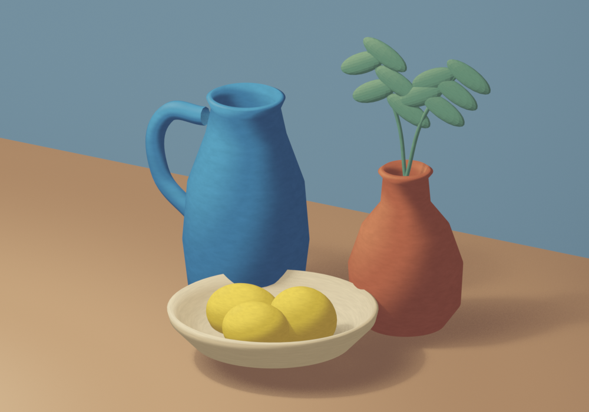
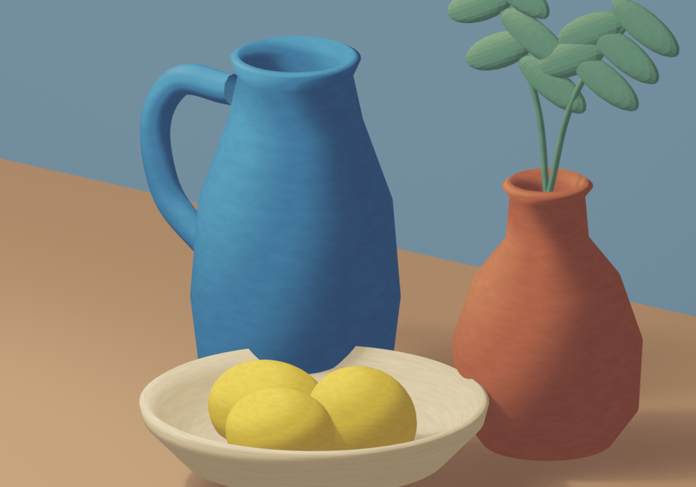

# Procedural pigment material study

Self-directed Blender still-life study made on 15 October 2026 for a conversation about a paid stylized-material task. This is not client work or a finished animation test.

The meshes, lathed vessels, leaves, lighting and materials are generated by `build.py`. The materials combine diffuse lighting through Shader to RGB, a four-color lighting ramp and stretched procedural noise for pigment variation. There are no stock meshes, image textures, purchased assets or third-party add-ons.

- Verified in Blender 5.1.2 with EEVEE: source saved and two PNGs rendered.
- The material is a soft procedural pigment/wash study, not hand-painted image texturing.
- Shader to RGB is EEVEE-specific. Cycles compatibility has not been demonstrated.
- The two stills do not verify temporal stability on an animated or deforming scene. That requires testing against the client's scene, camera and reference look before committing to delivery.
- `pigment-study.blend` opens with the whole-scene camera. Rebuild with Blender in background mode using `--factory-startup --python build.py`.

Contact: brokerloadbrew@gmail.com · itsallsame
